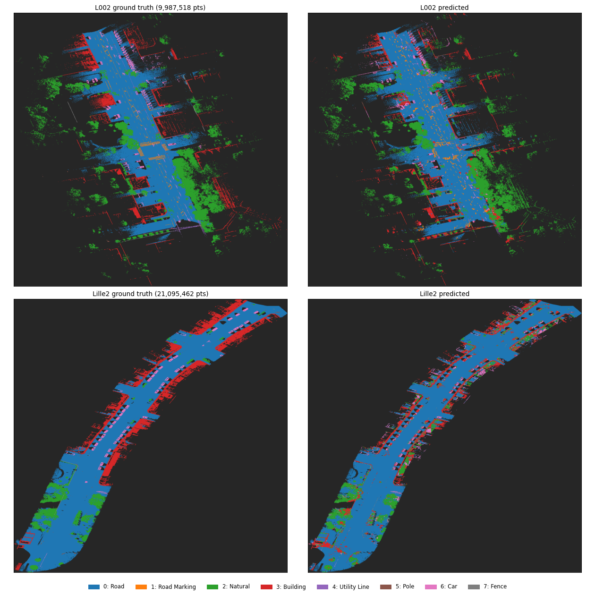
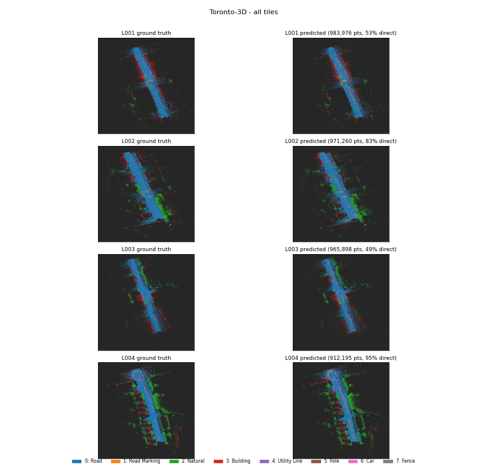
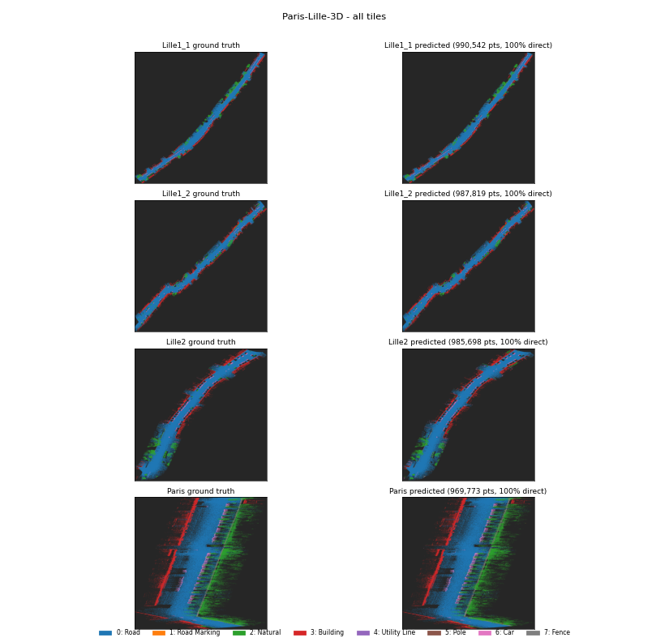
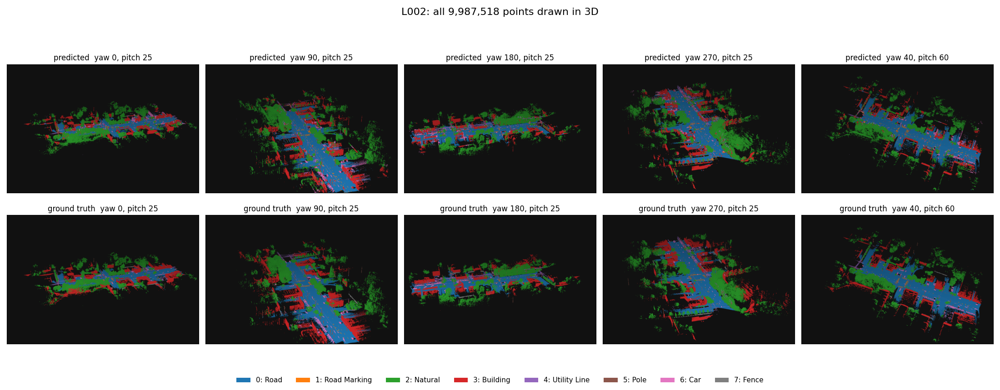
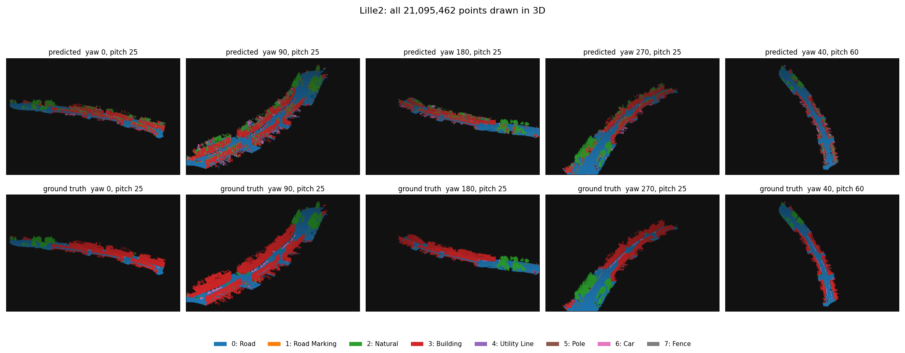
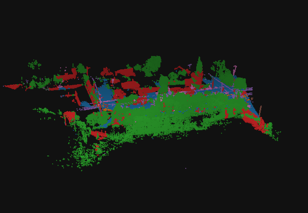
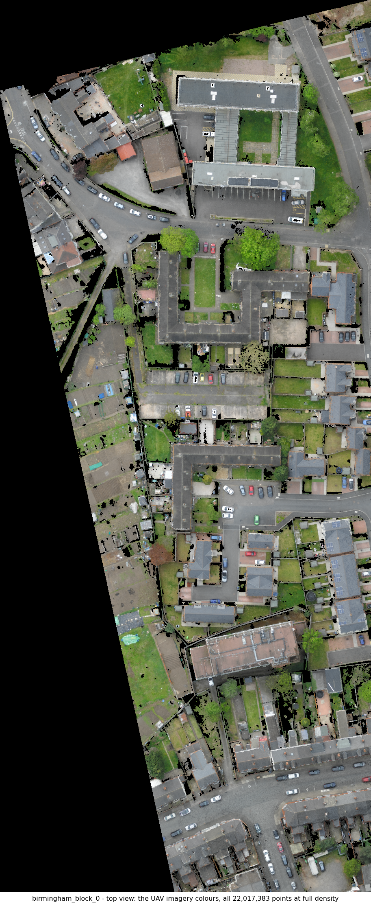
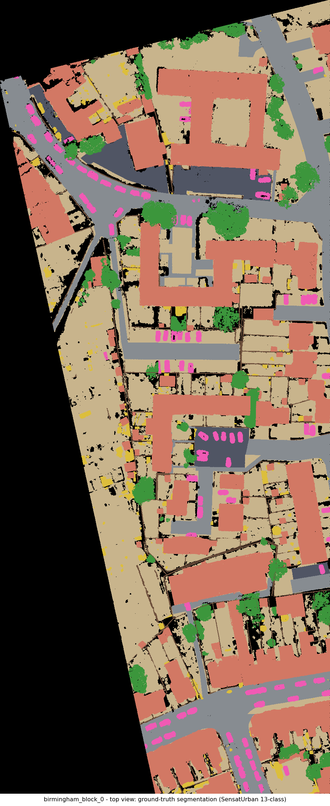
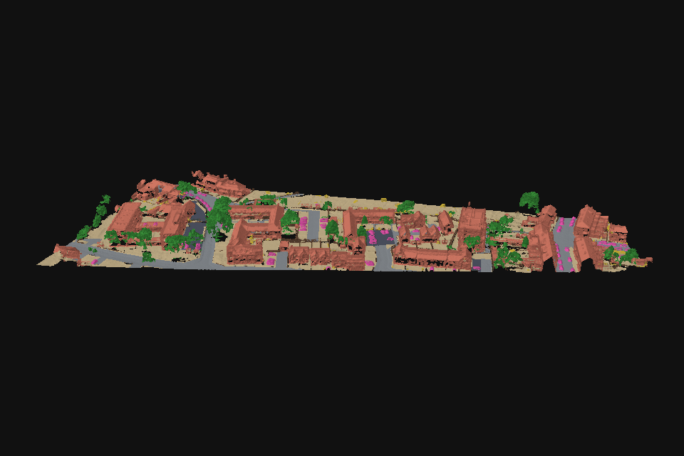
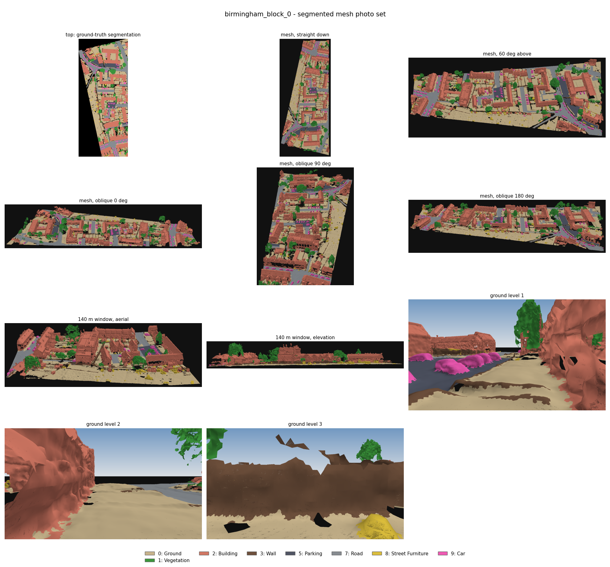

# Toronto-3D + Paris-Lille-3D PointNet++ Semantic Segmentation

<p align="center">
  
</p>

A notebook-first deep-learning project for semantic segmentation of large urban point clouds. The main implementation is a GPU-oriented PointNet++-style training, evaluation, and visualization notebook. Raw point-cloud datasets are intentionally not included in this repository package.

---

## 🎯 What the project does

- **Trains one 8-class model** using Toronto-3D (XYZ + RGB) and Paris-Lille-3D (XYZ + reflectance) tiles, mapped to a shared class set: **Road**, **Road Marking**, **Natural**, **Building**, **Utility Line**, **Pole**, **Car**, and **Fence**.
- **Architecture**: PointNet++ with KD-tree block sampling, farthest-point sampling in set-abstraction layers, 3-NN inverse-distance feature propagation, class-weighted loss, and GPU-based training/inference.
- **Evaluation**: Holds out Toronto tile `L002` and Paris-Lille tile `Lille2` from training for evaluation.
- **Visualizations**: Point-cloud renderings, optional Plotly interactive 3D viewing, Open3D meshing, and cross-dataset experiments on a raw Paris-Luxembourg scan and SensatUrban/Birmingham data.

The notebook is the project implementation; this package does not contain a separate Python library or command-line application.

---

## 📊 Results at a Glance

### Held-out Tile Performance

| Held-out Tile | Dataset | Overall Accuracy | mIoU | Coverage |
|:---|:---|---:|---:|---:|
| `L002` | Toronto-3D | **85.91%** | **0.3974** | 31.42% |
| `Lille2` | Paris-Lille-3D | **83.02%** | **0.2613** | 34.42% |

> **Note**: These are single-run results, not averages or independently reproduced benchmarks. `Lille2` is held out as a tile, but other Paris-Lille-3D tiles appear in training, so it is **not** a zero-shot cross-city result. The per-epoch validation split samples blocks randomly from training tiles; nearby blocks may overlap. Treat validation curves as a development signal, not an independent test.

### Per-Class IoU (L002 — Toronto-3D)

| Class | IoU |
|:---|---:|
| Road | 0.908 |
| Road Marking | 0.224 |
| Natural | 0.759 |
| Building | 0.491 |
| Utility Line | 0.330 |
| Pole | 0.115 |
| Car | 0.349 |
| Fence | 0.003 |

### Per-Class IoU (Lille2 — Paris-Lille-3D)

| Class | IoU |
|:---|---:|
| Road | 0.909 |
| Road Marking | 0.000 |
| Natural | 0.293 |
| Building | 0.650 |
| Utility Line | 0.000 |
| Pole | 0.076 |
| Car | 0.135 |
| Fence | 0.027 |

---

## 🖼️ Visual Results

### Toronto-3D (L002) — Prediction Gallery

<p align="center">
  
</p>

### Paris-Lille-3D (Lille2) — Prediction Gallery

<p align="center">
  
</p>

### 3D Orbit Visualizations

| Toronto-3D L002 | Paris-Lille-3D Lille2 |
|:---:|:---:|
|  |  |

### 3D Spin Animation (L002)

<p align="center">
  
</p>

---

## 🏙️ Cross-Dataset Experiments

### SensatUrban / Birmingham Block 0

The model was tested on SensatUrban Birmingham data as a cross-dataset experiment (no fine-tuning).

<p align="center">
  
</p>

<p align="center">
  
</p>

<p align="center">
  
</p>

<p align="center">
  
</p>

> **Note**: No verified Birmingham accuracy is reported; this is a qualitative cross-dataset experiment only.

---

## 🗂️ Repository Contents

```text
.
├── README.md
├── LICENSE
├── requirements.txt
├── .gitignore
├── Toronto3D_PointNetPP_ThreePLY_Training_and_Prediction_corrected.ipynb
├── assets/                          # Visual assets for README
│   ├── gallery_preview.png
│   ├── gallery_toronto.png
│   ├── gallery_paris_lille.png
│   ├── threed_orbit_L002.png
│   ├── threed_orbit_Lille2.png
│   ├── threed_spin_L002.gif
│   ├── birmingham_orthophoto.png
│   ├── birmingham_class_map.png
│   ├── birmingham_turntable.gif
│   └── birmingham_contact_sheet.png
└── results/
    ├── eval_report.json
    └── training_history.json
```

`results/` contains compact snapshots from one existing run. Checkpoints, raw datasets, prediction arrays, exported point clouds/meshes, and generated visual assets are not included. Running the notebook writes new artifacts under `data/outputs/`, which is ignored by Git.

---

## 🚀 Setup

Use a Python environment compatible with your local PyTorch, Jupyter, and Open3D builds. A GPU is recommended for training and large-tile inference; the notebook's configuration cell exposes the main runtime and memory settings.

1. **Create and activate a virtual environment.**
2. **Install PyTorch** matching your OS and CUDA setup using the [official PyTorch installation selector](https://pytorch.org/get-started/locally/). PyTorch is installed separately because the appropriate wheel depends on the machine.
3. **Install remaining dependencies:**

   ```bash
   python -m pip install -r requirements.txt
   ```

4. **Set `POINTNET_DATA_DIR`** to the directory containing the external datasets (layout below), then start Jupyter from this repository directory so generated outputs stay inside the ignored `data/outputs/` folder.

   **PowerShell:**
   ```powershell
   $env:POINTNET_DATA_DIR = "D:\datasets\pointnet-data"
   jupyter lab
   ```

   **macOS/Linux:**
   ```bash
   export POINTNET_DATA_DIR="/path/to/pointnet-data"
   jupyter lab
   ```

5. **Open** `Toronto3D_PointNetPP_ThreePLY_Training_and_Prediction_corrected.ipynb` and run the cells in order. Dependencies are managed outside the notebook; the notebook no longer installs packages into the active environment.

---

## 📁 External Data Layout

Obtain the datasets from their upstream sources and follow their terms. Point `POINTNET_DATA_DIR` at a parent folder with this structure:

```text
<POINTNET_DATA_DIR>/
├── Toronto_3D/
│   ├── L001.ply
│   ├── L002.ply
│   ├── L003.ply
│   └── L004.ply
├── training_10_classes/
│   ├── Lille1_1.ply
│   ├── Lille1_2.ply
│   ├── Lille2.ply
│   └── Paris.ply
├── Paris_Luxembourg_6.ply       # optional, unlabeled inference example
└── Birmingham_3D/
    └── birmingham_block_0.ply  # optional SensatUrban cross-dataset example
```

- **Training tiles (6)**: `L001`, `L003`, `L004`, `Lille1_1`, `Lille1_2`, `Paris`
- **Held-out evaluation tiles (2)**: `L002`, `Lille2`
- **Optional**: Paris-Luxembourg scan (unlabeled inference), Birmingham/SensatUrban (cross-dataset experiment)

The `test_10_classes/` folder and other local assets from the original workspace are not required by the main configured training/evaluation path.

If the datasets are placed directly in the repository folder instead, leave `POINTNET_DATA_DIR` unset. Dataset folders and common point-cloud/checkpoint artifacts are ignored by `.gitignore` to reduce the chance of committing large files accidentally.

---

## 📚 Dataset Sources, Citations, and Licensing

This repository does **not** redistribute the source point clouds or dataset-derived figures. Obtain each dataset from its source and check its current terms before use or publication:

- **Toronto-3D**: [Dataset repository and download information](https://github.com/WeikaiTan/Toronto-3D) (described as CC BY-NC 4.0).  
  Citation: Tan et al., *Toronto-3D: A Large-scale Mobile LiDAR Dataset for Semantic Segmentation of Urban Roadways* ([paper](https://arxiv.org/abs/2003.08284)).

- **Paris-Lille-3D**: [NPM3D dataset page and access terms](https://npm3d.fr/paris-lille-3d) (lists CC BY-NC-ND 3.0).  
  Citation: Roynard, Deschaud, and Goulette, *Paris-Lille-3D: a large and high-quality ground-truth urban point cloud dataset for automatic segmentation and classification of urban scenes* ([paper](https://arxiv.org/abs/1712.00032)).

- **SensatUrban**: [Official project repository](https://github.com/QingyongHu/SensatUrban) and its referenced publications. The repository's MIT code license does not by itself establish a license for the dataset; confirm data-use and redistribution terms with the dataset owners.

The `LICENSE` applies the MIT License **only to original code authored for this project**. It does not grant rights in upstream datasets or dataset-derived materials, including the tracked metric/history snapshots; those remain subject to their source terms. No point clouds, checkpoints, prediction arrays, or dataset-derived figures are included. Confirm that the terms permit sharing any data-derived outputs before reusing them.

---

## ⚙️ Notes

- Full training and large-scene processing can require substantial GPU memory, disk space, and time. Start with the configuration cell and skip optional meshing/cross-dataset sections if their inputs or dependencies are unavailable.
- The notebook saves generated checkpoints, reports, predictions, and visualizations under `data/outputs/`; this directory is ignored. Only the two curated JSON snapshots under `results/` are intended to be tracked by this package.
- `requirements.txt` lists package names without version pins; it is not a tested lockfile. Pin versions after validating the target Python/CUDA environment if reproducibility is required.

---

## 🔗 Interactive Visualizations (Generated by Notebook)

Running the notebook produces interactive HTML visualizations (opens in browser):

- `data/outputs/threed_interactive_L002.html` — Toronto-3D L002 interactive 3D view
- `data/outputs/threed_interactive_Paris_Luxembourg_6.html` — Paris-Luxembourg interactive 3D view
- `data/outputs/mesh_interactive_Paris_Luxembourg_6.html` — Paris-Luxembourg mesh view

---

## 📄 License

This project is licensed under the MIT License — see the [LICENSE](LICENSE) file for details. **This license applies only to original code authored for this project**, not to upstream datasets or dataset-derived materials.